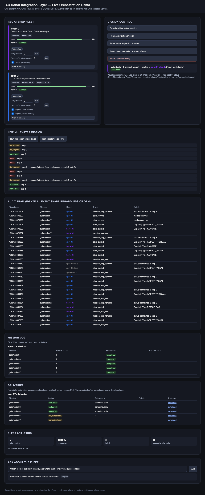

# IAC Robot Integration Layer — Technical Assessment

The design doc is [`DESIGN.md`](DESIGN.md) — start there. This directory also
contains a **working proof of concept** — two genuinely different OEM
adapters running behind one platform API — in two forms: a CLI demo, and
a real browser-based GUI with a recorded session proving it live.

## Live GUI

`webapp/` is a real Flask app + browser dashboard — not a mockup. Run it
and click through it yourself:

```bash
.venv/bin/pip install flask
.venv/bin/python webapp/app.py
# open http://127.0.0.1:5055
```

It shows the registered fleet (one card per robot, color-coded by OEM),
buttons to run each mission type, and a live audit trail — every click
calls the real `OrchestrationService` used everywhere else in this repo.
`webapp/app.py` is a thin wrapper; it does not reimplement capability
resolution or mission execution.

Beyond the original fleet cards and mission buttons, the dashboard now
also shows: a robot health panel (power/network/sensor status per
robot), fault-injection controls per robot (deterministic and
probabilistic), a live multi-step mission execution view driven by
Server-Sent Events with a real-time per-step timeline, a per-robot
Mission Log, a Fleet Analytics panel (success rate, retries, failures,
paused-for-intervention counts), and an "Ask about the fleet"
natural-language query box. The query box works out of the box with a
deterministic template engine; set `ANTHROPIC_API_KEY` (and
`pip install anthropic`) for full LLM-powered answers instead.
It also now shows a Deliveries panel, per robot: the mission data
package's upload/webhook-push status and a download link, driven by the
same real backend described below.

**Recorded evidence it actually works**, captured by driving the real app
in real headless Chromium via Playwright (`webapp/record_gui_demo.py`) —
not hand-picked screenshots, a scripted click-through of an actually
running server:

- `webapp/output/screenshot_initial.png` — fleet loaded, zero missions run
- `webapp/output/screenshot_final.png` — after all three missions, audit trail populated
- `webapp/output/gui_demo.mp4` — **open this one on macOS.** H.264/yuv420p,
  plays in QuickTime and any browser.
- `webapp/output/gui_demo.webm` — the original Playwright capture (VP8/Opus).
  QuickTime and most native macOS tools won't play `.webm` directly — the
  `.mp4` above is a straight ffmpeg transcode of this file, same content,
  not a re-recording.

To reproduce the recording:

```bash
.venv/bin/pip install playwright
.venv/bin/playwright install chromium
brew install ffmpeg          # optional -- only needed for the .mp4 transcode
.venv/bin/python webapp/record_gui_demo.py
```



## Run it with Docker (no local Python setup needed)

```bash
docker compose up --build
# open http://127.0.0.1:5055
```

Or without compose:

```bash
docker build -t iac-robot-integration .
docker run -p 5055:5055 iac-robot-integration
```

This runs the exact same `webapp/app.py` as the "Live GUI" section above —
real `OrchestrationService`, real fault injection, real delivery pipeline
(the in-process mock-customer webhook server runs inside the container too) —
reachable from your host machine's browser. Verified directly: built the
image, ran a mission through it, swapped the OEM provider live, and confirmed
a real webhook delivery against the containerized mock-customer server, all
over the published port.

The image deliberately does **not** attempt to build `cpp_nodes/` (that
would require a full ROS2 toolchain) — see "What's real vs. illustrative"
below; it packages the real Python platform only. To also run the test suite
or the CLI demo inside the container without a rebuild:

```bash
docker run --rm iac-robot-integration python -m pytest tests/ -v
docker run --rm iac-robot-integration python demo/run_demo.py
```

`requirements.txt` has the core dependencies the image installs.
`requirements-optional.txt` (playwright for re-recording the GUI video,
anthropic for real LLM-powered fleet queries) is **not** installed by
default — see that file for why.

## Multi-step missions, resilience, and fleet analytics

Beyond the original single-step PoC above, the orchestration core now
actually executes multi-step missions end to end, handles failures the
way a real fleet operator would want, and keeps live fleet statistics —
no new OEM adapters needed, none of it is a parallel code path.

- **Multi-step missions actually execute, sequentially.** `Mission.steps`
  used to be a dormant field; it now drives real execution, one step
  after another, with per-step progress callbacks via
  `OrchestrationService.run_mission_with_progress()`, backed by
  `integration_layer/core/mission_executor.py`.
- **Module-aware retry.** Every failure is classified by the
  `SystemModule` actually implicated (comms / sensor / power / safety /
  planning) and handled per a policy table in
  `integration_layer/core/retry_policy.py`: comms failures retry with
  increasing backoff; sensor and safety failures never auto-retry and
  instead pause the mission for operator intervention; power and
  planning failures fail outright (retrying a low-battery abort or a bad
  precondition doesn't fix anything).
- **Hybrid fault injection.** `mock_robot/fault_injection.py`'s
  `FaultProfile` supports both deterministic faults (`set_offline`,
  `set_flaky`, `set_sensor_failed`) for reproducible demos and tests, and
  probabilistic faults (`set_random_failure_rate`, seeded via
  `FaultProfile.rng_seed`) for realistic, less-predictable conditions —
  both kinds funnel through the exact same retry policy, so the system
  doesn't need to know or care which kind of fault it's seeing.
- **Automatic fleet/robot analytics.** `integration_layer/core/mission_analytics.py`
  updates incrementally the instant a mission ends — no manual trigger,
  no batch recompute — and is queryable via
  `OrchestrationService.get_fleet_stats()` / `get_robot_stats()`.
- **Natural-language fleet querying.** The GUI's "Ask about the fleet" box
  is backed by `integration_layer/core/stats_query.py`: a deterministic
  template engine answers common questions by default, or, if
  `ANTHROPIC_API_KEY` is set (and `pip install anthropic` is additionally
  done), real Claude API answers take over. The template engine needs
  neither the package nor the key.

See it live: `demo/run_demo.py`'s resilience-demo section walks all four
fault postures against the real retry policy and prints fleet analytics
at the end; in `webapp/`, the health panel, fault-injection controls,
live multi-step mission execution, Mission Log, Fleet Analytics panel,
and Ask-about-the-fleet box are all driven by the same real backend.

## Post-mission data capture, upload, and customer delivery

Beyond executing missions and tracking their outcomes, the system now
captures what each mission actually *produced* and gets it to the
customers who asked for it — end to end, no manual step in between.

- **Local, no-network artifact capture, the instant each sensor step
  completes.** Any step with capability `inspect_visual`,
  `inspect_thermal`, or `detect_gas` captures a simulated sensor artifact
  (image/thermal-image/gas-reading file) the moment it finishes, via
  `ArtifactCapture` (`integration_layer/core/artifact_capture.py`). This
  is pure local file I/O — no network involved, nothing to retry.
- **One batch upload at mission end, governed by the SAME resilience
  policy as mission execution.** The moment a mission reaches
  `COMPLETED`, `MissionExecutor` automatically uploads the mission's
  captured artifacts from "robot" to "platform" — the one
  network-dependent leg of this flow — subject to the same
  `FaultProfile` and retried via the same `retry_policy` COMMS strategy
  that already governs mission-step execution. Nothing new to configure,
  nothing new to reason about: a flaky or offline robot behaves the same
  way for its data as it does for its mission steps. A robot that goes
  offline right as its mission completes can still COMPLETE the mission
  while its data never makes it off the robot (`DeliveryStatus.UPLOAD_FAILED`,
  exercised directly in `tests/test_data_delivery.py`); `demo/run_demo.py`'s
  delivery demo section shows the nominal delivery path plus the related
  (but distinct) case of a robot offline for an entire mission, which fails
  the mission outright before delivery is ever attempted.
- **Packaging and customer delivery.** On a successful upload,
  `DeliveryPackager` builds a `mission-report-<id>.zip` (manifest +
  artifact files), and `CustomerRegistry`
  (`integration_layer/core/customer_registry.py`) finds every customer
  subscribed to that robot/capability combination. Each matched customer
  gets a real local HTTP webhook push — retried via the same COMMS
  policy — against `mock_customer/customer_server.py`, a genuinely
  separate, real local Flask process simulating a customer's receiving
  system, not a mocked call.
- **See it in the GUI.** The dashboard's new Deliveries panel shows, per
  robot, mission data package status and a download link, backed by
  three new endpoints: `GET /api/missions/<id>/delivery`,
  `GET /api/robots/<id>/deliveries`, and
  `GET /api/deliveries/<id>/download`.
- **Production mapping and scaling path, stated explicitly rather than
  left implied:** the downloadable zip here would really be an object in
  S3 behind a presigned URL, not a file assembled and held by this
  process. The webhook push would really hit the customer's registered
  AWS API Gateway/EventBridge endpoint — not implemented here, and
  notably there's no payload signing or auth on the webhook push in this
  PoC, a documented gap rather than an oversight. At real scale, bundling
  bytes into a per-mission zip doesn't hold up: mission metadata would
  live in a document/relational store with artifacts in object storage
  referenced by key, not bundled together, and bulk analytics export
  across many missions would use Parquet/Avro rather than JSON, for the
  same reason the audit log is indexed rather than scanned.

## Proof of concept (CLI form): what it proves and how to run it

Two robots, two different adapter implementations, same platform API:

| | `spot-01` | `fleetx-01` |
|---|---|---|
| Adapter | `MockRobotAdapter` (`mock_robot/mock_robot_node.py`) | `CloudFleetAdapter` (`mock_robot/cloud_fleet_adapter.py`) |
| Represents | local/ROS2-style OEM | cloud/REST-style OEM |
| Internal mechanics | synchronous-ish, completes a step on first call | async job submission + polling (needs 2 polls to resolve) |
| Power field | `_battery_pct` | `_soc_percent` |
| Error vocabulary | normalized directly | own codes (`ERR_PAYLOAD_FAULT`, etc.) mapped in-adapter |

Both implement the exact same `RobotAdapter` interface
(`integration_layer/core/adapter_base.py`). Nothing OEM-specific —
not the polling behavior, not the field names, not the error codes —
crosses that boundary.

```bash
python3 -m venv .venv
.venv/bin/pip install pytest matplotlib pillow   # pillow only needed for the video
.venv/bin/python -m pytest tests/ -v             # 195/195 — conformance + platform-agnosticism + retry/fault-injection/analytics/LLM-query/data-delivery
.venv/bin/python demo/run_demo.py                # runs the demo, writes demo/output/
.venv/bin/python demo/make_pipeline_video.py      # records a video of the pipeline running
```

### CLI pipeline video

`demo/output/video/pipeline_demo.gif` — this one predates the GUI above.
Before `webapp/` existed, there was no GUI and no ffmpeg/screen-capture
tool available, so `demo/make_pipeline_video.py` does the honest
equivalent: it runs the **real** demo code, captures its **real** stdout,
and renders that real output as a scrolling terminal animation, ending on
the real `mission_timeline.png` chart. Nothing in it is staged or
invented — every frame is either genuine captured output or the genuine
generated chart. Kept alongside the GUI recording as a second, independent
form of evidence (and because it doesn't need a browser to view). If
`ffmpeg` is on `PATH` it also writes an `.mp4`; otherwise the GIF (which
plays natively in any browser or image viewer) is the artifact.

`demo/run_demo.py` runs three missions (visual inspection, gas detection,
thermal inspection) through one function, `run_mission()`, that never
branches on which OEM it's talking to. Two missions resolve to `spot-01`,
one to `fleetx-01`, purely because of which robot advertises the
requested capability — not because the calling code knows or cares.
Output:

- `demo/output/demo_run.txt` — captured log of the run (registration,
  per-mission routing decision, full audit trail)
- `demo/output/mission_timeline.png` — visual demonstration: a swimlane
  chart, one lane per robot, showing which OEM served each mission and
  that all three completed

### Where the "switch the robot, don't touch the platform" claim is actually tested

`tests/test_platform_agnosticism.py` is the direct evidence for this.
`run_inspection_mission()` in that file is written once, then:
- run against a registry containing only the local OEM
- run against a registry containing only the cloud OEM
- run against a registry containing both, where routing is decided
  entirely by data (which robot advertises the requested capability),
  never by a branch in the calling code
- run twice against a `Mission` whose `assigned_robot_id` is explicitly
  pinned to each OEM in turn — proving a mission can be redirected to a
  completely different OEM by changing data, not code

### Bugs this process actually caught

Writing the second adapter and the parametrized conformance suite
surfaced two real bugs before they shipped, not hypothetical ones:
1. `MockRobotAdapter.__init__` used `payload or {"visual_camera"}` — an
   explicitly-passed empty `set()` is falsy in Python, so a robot with no
   payload silently got the default payload instead. Fixed to
   `payload if payload is not None else ...`.
2. `CloudFleetAdapter`'s low-power short-circuit in `execute_mission_step`
   returned the correct `LOW_BATTERY_ABORT` status directly, but never
   recorded it — so a subsequent `get_status()` poll (which any real
   caller does) saw "unknown job" and reported `ADAPTER_UNRESPONSIVE`
   instead. Fixed by recording a `forced_status` on every terminal path,
   not just the ones reached through normal job polling.

This is the conformance-suite argument from `DESIGN.md` section 1 playing
out directly: the suite caught both of these because it runs the same
tests against both adapters and insists on the same terminal-status
contract either way.

## What's real vs. illustrative

- **Runs, is tested, and is demoed**: everything under `integration_layer/`
  (except `adapters/ros2_generic/`), `mock_robot/`, `mock_customer/`,
  `tests/`, `demo/`, and `webapp/`. Pure Python, no ROS2/hardware
  dependency.
- **`mock_customer/customer_server.py` is a real local HTTP process**,
  not a mocked call: it's a genuine Flask app run in a background thread,
  hit with real HTTP requests in `tests/test_customer_server.py` and
  `tests/test_data_delivery.py`, and used the same way by `webapp/`'s
  live delivery flow. The AWS S3/API-Gateway production mapping described
  in "Post-mission data capture, upload, and customer delivery" above is
  illustrative only — not built, not called anywhere in this repo.
- **Illustrative, not built or run**: `integration_layer/adapters/ros2_generic/adapter.py`
  and everything in `cpp_nodes/`. Written against the real `rclpy`/`rclcpp`
  API surface for correctness of shape — implementing the same
  `RobotAdapter` interface the two PoC adapters implement — but there's no
  ROS2 install in the environment this was built in, so they haven't been
  compiled or run against real middleware. `DESIGN.md` section 4 treats
  that verification (bench-testing an adapter against real hardware) as
  real first-30-days engineering work, not something to claim as done here.
  `cpp_nodes/` follows a standard `ament_cmake` package layout
  (`src/`/`launch/`/`config/`, declared ROS2 parameters instead of
  hard-coded constants, `ament_lint_auto` test dependencies) and now covers
  five subsystems — safety, motion relay, power, inspection payload, and
  diagnostics aggregation — see `cpp_nodes/README.md` for the node topology.

## Layout

```
DESIGN.md                            # the design doc
schemas/mission.proto                # the canonical wire contract
integration_layer/
  core/                              # capability model, mission/status schema,
                                     # adapter interface, registry, audit log
    adapter_base.py                  # the RobotAdapter interface both OEM adapters implement
    retry_policy.py                 # module-aware retry policy table
    step_runner.py                  # single-step execution, owns its own retries
    mission_executor.py             # cross-step sequencing + post-mission analytics hook
    mission_analytics.py            # incremental fleet/robot statistics
    stats_query.py                  # template + Anthropic LLM query engines
    artifact_capture.py             # local, no-network per-step simulated sensor capture
    customer_registry.py            # which customers get which mission's delivered data
    data_delivery.py                # two-phase upload+push delivery, both retried via retry_policy
    events.py                       # audit log event shape
    mission.py                      # Mission/MissionStep schema
    registry.py                     # fleet/capability registry
  adapters/ros2_generic/adapter.py  # ROS2 worked example (illustrative, see above)
  api/orchestration_service.py      # thin facade over MissionExecutor
cpp_nodes/                            # ROS2 ament_cmake package, 5 nodes (illustrative, see cpp_nodes/README.md)
mock_robot/
  mock_robot_node.py                # OEM adapter #1: local/ROS2-style
  cloud_fleet_adapter.py            # OEM adapter #2: cloud/REST-style
  fault_injection.py                # hybrid deterministic + probabilistic FaultProfile
mock_customer/
  customer_server.py                 # real local Flask app simulating a customer's receiving system
demo/
  run_demo.py                       # PoC demo: same call path, both OEMs
  make_pipeline_video.py            # records demo/run_demo.py's real output as a video
  output/
    demo_run.txt                    # captured log from the last demo run
    mission_timeline.png            # swimlane chart of the last demo run
    video/pipeline_demo.gif         # video of the pipeline running (see "Video" above)
webapp/
  app.py                             # Flask wrapper around the real OrchestrationService
  templates/index.html               # the dashboard (vanilla HTML/CSS/JS, no build step)
  record_gui_demo.py                 # drives the real GUI in headless Chromium, records it
  output/
    screenshot_initial.png           # real screenshot: fleet loaded, no missions run
    screenshot_final.png             # real screenshot: after 3 missions, audit populated
    gui_demo.webm                    # real recorded browser session (Playwright native format)
    gui_demo.mp4                     # same recording, transcoded for macOS playback
tests/
  test_adapter_contract.py          # conformance suite, parametrized over both OEMs
  test_platform_agnosticism.py      # proves the robot can be swapped without
                                     # changing platform-facing calling code
  test_webapp_api.py                # tests for the Flask API layer (now incl.
                                     # health, fault controls, live SSE mission,
                                     # mission log, fleet stats, stats-query,
                                     # delivery endpoints)
  test_retry_policy.py              # module-aware retry policy table
  test_fault_injection.py           # deterministic + probabilistic FaultProfile
  test_step_runner.py               # single-step execution + retry
  test_mission_executor.py          # cross-step sequencing + analytics hook
  test_mission_analytics.py         # incremental fleet/robot statistics
  test_stats_query.py               # template + Anthropic LLM query engines
  test_multistep_missions.py        # end-to-end multi-step mission execution
  test_audit_log_indexing.py        # per-mission/per-robot audit log indices
  test_artifact_capture.py          # local no-network per-step simulated sensor capture
  test_customer_registry.py         # robot/capability -> subscribed-customer matching
  test_customer_server.py           # mock_customer/customer_server.py, real local HTTP calls
  test_data_delivery.py             # two-phase upload+push delivery, retries, failure modes
```

## How I used AI

See the last section of `DESIGN.md` for the original design-doc work.
For this proof-of-concept iteration specifically: I used AI to generate
the second OEM adapter, the parametrized conformance suite, the
platform-agnosticism tests, and the demo script, following the
architecture already committed to in `DESIGN.md`. My review wasn't just
reading the diff — I ran the full suite after each change, and when it
surfaced the two real bugs listed above, I had AI explain the failure,
confirmed the root cause myself against the actual code (not just the
stack trace), and reviewed the fix before accepting it. The first
version of the timeline chart I generated was also wrong in a way I
caught by actually looking at the image — mission bars plotted against
real wall-clock time were overlapping unreadably because in-process mock
calls complete in microseconds — so I had it redone against mission order
instead of wall-clock time, which is what's actually meaningful for a
demo like this.

For the GUI (`webapp/`): AI generated the Flask wrapper, the dashboard
HTML/CSS/JS, and the Playwright recording script. I verified it the same
way as everything else — by running it, not reading it. The first
recording attempt was wrong in a way that mattered: a stale Flask process
from an earlier manual `curl` test was still bound to the port, so the
"initial, zero missions run" screenshot actually showed two missions
already in the audit log. I caught that by looking at the screenshot
content, not just confirming the script exited 0 — a successful script
run and a correct artifact are different claims, and I checked both. I
had the script hardened to fail loudly on a port conflict instead of
silently recording against a stale server, then re-ran it and verified
the corrected initial/final screenshots by hand before treating the
recording as evidence.

Separately: the recording was handed over as a `.webm`, which doesn't
play natively on macOS (QuickTime and most native tools don't support
it). I had the recording script extended to also transcode to H.264
`.mp4` via ffmpeg right after capture, rather than leaving that as a
manual one-off conversion step — then re-ran the whole recording script
end to end (not just the conversion command) to confirm the transcode is
actually wired into the pipeline, and extracted a frame from the
resulting `.mp4` to visually confirm the converted file's content matches
the original recording, not just that `ffprobe` reports a valid codec.

For this expansion (multi-step execution, module-aware retry, hybrid
fault injection, fleet analytics, LLM querying, and the GUI upgrade that
surfaces all of it): I pushed back on the first AI-proposed plan twice
before implementation started, not after. First, the initial design put
all multi-step/retry logic inline in one method — I rejected that as a
single point of failure with no way to test retry behavior independently
of sequencing, and the plan was revised into decomposed, independently
testable components (`StepRunner` owns single-step execution and its own
retries; `MissionExecutor` owns cross-step sequencing and the
post-mission analytics hook; `OrchestrationService` was then rewritten as
a thin facade over both). Second, the initial fault-injection design was
deterministic-only — I rejected that as unrealistic for a system meant to
demonstrate resilience, and the plan was revised to a hybrid: deterministic
countdowns (for reproducible tests/demos) plus seeded-probabilistic
failure rates (for genuinely unpredictable-looking conditions), both
funneled through the same retry policy so neither the orchestration code
nor the demo narrative has to special-case which kind of fault it's
seeing.

Implementation itself was carried out via a subagent-driven process: a
fresh implementer subagent per task, followed by an independent reviewer
subagent with no access to the implementer's reasoning, only the diff and
the brief. This caught real things, not just style nits — worth naming
specifically rather than vaguely: in the task that added `StepRunner`
(single-step execution with owned retries), the reviewer independently
hand-traced the retry/backoff arithmetic against `retry_policy.py`'s
actual formula rather than trusting the implementer's report, and
confirmed it exact (4 total calls for `max_attempts=4`, correct backoff
index at each step). In the task that added `MissionExecutor`, the
implementer didn't just claim the mixed-fleet routing fix was correct —
they empirically proved it by temporarily reintroducing the exact bug the
design called out (resolving each subsequent step's adapter by robot
instead of by capability) and re-running the mixed-fleet test to confirm
it failed in exactly the expected way, then restored the correct code and
confirmed the test passed again. In the task that rewrote
`OrchestrationService` as a thin facade — the single highest-risk change
in this whole expansion, since it's the one thing every other component
calls through — the reviewer re-verified from scratch, independently of
the implementer's own report, that the three pinned regression-gate files
(`test_adapter_contract.py`, `test_platform_agnosticism.py`,
`test_webapp_api.py`) still produced a byte-for-byte empty `git diff`
against the pre-rewrite commit, not just that the tests passed. I
repeated that same pinned-diff check myself in this closing task, against
the commit from before this entire plan's work began (not just the
previous task), and it's still genuinely empty — see the regression-gate
section above. `StepRunner`'s resumable-polling design (continuing a
step's retry loop from partial state without a fresh `execute` call) was
also independently verified twice, once when it was introduced and again
when `MissionExecutor.continue_mission` was built on top of it, rather
than assumed correct because it worked once.

For this round (post-mission data capture, upload, and customer
delivery): I asked for mission data to actually get downloaded,
uploaded, and delivered to customers after a mission completes, plus
honest documentation of the design decisions behind it. Before any code
was written, this went through the brainstorming skill's full Q&A cycle —
capture scope (which steps produce artifacts, and whether capture itself
touches the network), delivery mechanism (zip package vs. something
else), upload direction and timing (per-step vs. one batch at mission
end, and whose retry policy governs it), and webhook target. On that
last point I explicitly redirected away from the first proposal, which
was to wire in real AWS (S3 + API Gateway/EventBridge) — I chose the
cheaper, safer path of a real *local* mock-customer server with an
explicit, documented production mapping instead, consistent with how the
rest of this repo treats "real but local" over "mocked" or "actually
cloud-dependent." One refinement got made while writing the spec, not
separately asked for: splitting "upload" into two independently-retried
network legs (robot→platform reusing the mission's own `FaultProfile`,
then platform→customer reusing the same retry policy against a real HTTP
call) instead of one undifferentiated upload step — worth flagging as a
refinement made in the course of writing the design, not something I
requested directly.

Execution was carried out the same subagent-driven way as the prior
expansion: implementer subagents per task, independent reviewers with
only the diff and the brief, no shared reasoning between the two. A few
things from this round are worth citing specifically rather than glossing
over: twice during execution a subagent crashed mid-response from an API
connection error — once a fix-dispatch attempt that crashed before doing
any work or committing, and once (on a later task) an implementer that
crashed after it had already committed its work but before it got to
write a report. Both times the real state was established by checking
`git log`/`git status` directly rather than trusting or waiting on the
agent's self-report, and work continued cleanly from there. Because that
second crash left no implementer report to review against, the reviewer
on that task didn't skip verification — it independently ran the demo
script itself end to end to confirm the actual output: a real HTTP round
trip to the mock-customer server, and correct scoping of the
offline-mission scenario (a mission-level failure, not a fabricated
delivery failure). Two Important review findings also got fixed via
follow-up dispatches rather than waved through: a missing
`backoff_for_attempt()` call in `DeliveryService`'s retry loops (retries
were firing with zero delay, against the plan's explicit requirement to
reuse the same backoff mechanism), and an untested code branch in
`OrchestrationService`'s `_executor_for` (the custom-poll-config path
that threads a `delivery_service` through a throwaway executor) — both
resolved and re-verified rather than left as known gaps.
